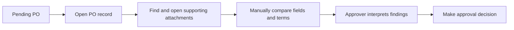
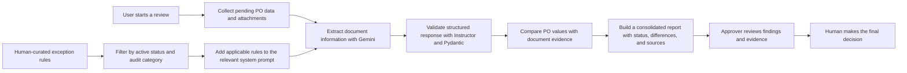
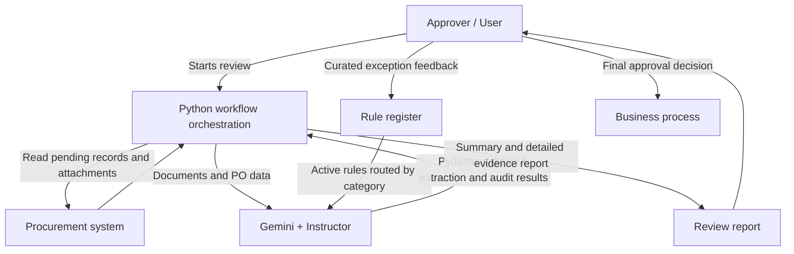

# AI-Assisted Procurement Review

> **An anonymized portfolio case study in LLM orchestration, structured output validation, and human-in-the-loop decision support.**
>
> I implemented an AI-assisted workflow that gathers purchase-order (PO) data and supporting documents, checks key fields against that evidence, and presents a review report to an executive approver. The AI provides an initial assessment; a person retains the final approval decision.

## Executive Summary

- **Business problem — As-Is:** An executive approver needed to review PO data alongside supporting documents. Manually locating and comparing information across records created administrative effort and made it harder to focus attention on exceptions.
- **Solution — To-Be:** A user-triggered Python workflow collects pending PO data and attachments, uses Gemini to extract and compare information, constrains the response shape with Instructor and Pydantic, then generates a consolidated, evidence-oriented report.
- **Business value:** The approver receives a consistent first-pass review with highlighted exceptions and source references. The workflow supports—not replaces—human judgment; AI findings are not automatic approvals.
- **Operational signal:** In approximately the first six months after deployment, observed use averaged about **1–2 runs per day**, typically covering **1–3 POs per run**. The end user described the report as helpful. These are operational observations, not a measured time-saving, accuracy, or ROI study.

## Business Context

The intended user is a senior approver reviewing purchase orders before deciding whether to proceed. The task requires comparing system records with evidence in attached documents, such as quoted items, quantities, prices, and commercial terms.

The goal was not to delegate approval to AI. It was to prepare a consistent first-pass review, organize relevant evidence, and direct the approver's attention to potential discrepancies. Early use also surfaced cases where the model was too strict and flagged acceptable information. That feedback reinforced the need for a human decision-maker and an iterative way to handle recurring exceptions.

## Process: As-Is vs. To-Be

### As-Is — Manual review



### To-Be — Evidence-oriented review assistance



## Solution Overview

The workflow separates collection, AI-assisted analysis, and reporting:

1. **Collect:** A browser automation workflow retrieves pending PO details and downloads associated documents.
2. **Extract:** Gemini processes supported PDF and image attachments into typed document and line-item data.
3. **Audit:** Separate price- and item-review stages compare extracted evidence with PO data. Evidence selected during the price review can inform the subsequent item review.
4. **Report:** Results are organized into an executive summary and detailed checks, with red findings prioritized and source files recorded where available.
5. **Decide:** The approver reviews the report and supporting evidence, then makes the final decision.

### High-level architecture



## LLM Harness: Constrain the Output, Keep the Decision Human

A central engineering goal was to make model responses more predictable and usable by downstream code—not to claim that a schema can make an LLM infallible.

- **Pydantic response models** define required fields and allowed status values for extraction and audit results.
- **Instructor** requests model responses in those Pydantic-defined shapes.
- **Validators and normalization** handle selected missing or inconsistent values before report generation.
- **Application-owned report assembly** converts named checks into report rows, rather than asking the model to invent report structure.
- **Evidence and human review** remain essential: valid JSON and field types do not prove that an AI conclusion is factually correct.

The following is an **illustrative, anonymized example**, not copied production code:

```python
from typing import Literal

from pydantic import BaseModel, Field


class Checkpoint(BaseModel):
    name: str
    system_value: str
    evidence_value: str
    status: Literal["GREEN", "RED"]
    explanation: str


class AuditReport(BaseModel):
    overall_status: Literal["GREEN", "RED"]
    checkpoints: list[Checkpoint] = Field(min_length=1)


# `instructor_client` is an already-configured Instructor client.
report = instructor_client.chat.completions.create(
    model="configured-model",
    response_model=AuditReport,
    messages=[{"role": "user", "content": "Review the supplied synthetic evidence."}],
)
```

This contract helps reject responses that do not conform to the expected structure. It does **not** validate whether the model interpreted a document correctly or whether a comparison is substantively right; those require evidence checks and human judgment.

## Feedback Loop for Recurring Edge Cases

### The problem I addressed

After the initial release, users continued to encounter exceptions that the model did not handle consistently. Updating a fixed system prompt for every new case would make routine maintenance slow and difficult to govern.

### The design

I designed and implemented a lightweight, human-curated prompt update mechanism:

1. Keep stable system-prompt content separate from the exception-rule register.
2. Record a proposed handling note with a review status and an audit category.
3. At runtime, select only rules marked active and relevant to the current audit category.
4. Add the selected rules to the corresponding prompt before the extraction or audit step.
5. Review subsequent output with the usual evidence and human-approval controls.

This creates a **curated feedback loop**: recurring user feedback can become reusable guidance after it has been reviewed and categorized. It is not autonomous learning, and it does not automatically turn arbitrary feedback into a trusted rule.

I considered retrieval-based approaches such as vector search, but the observed rule volume was small enough to include relevant active guidance directly in the prompt. This kept the solution simpler and easier to operate for the use case at hand.

## My Contribution

### Phase 1 — Initial delivery

The initial business requirements and high-level concept had already been established by my manager. I translated that direction into a working implementation and handled the technical follow-through, including testing, acceptance support, and deployment.

### Phase 2 — Post-launch improvement

After deployment, I identified a recurring operational pattern: new edge cases led to repeated prompt edits. I independently conceived, designed, and implemented the categorized, status-controlled prompt-injection mechanism described above. I reviewed the approach with the project PM before proceeding, then completed the implementation and deployment.

This second phase expanded my role from implementation into problem framing, solution design, trade-off evaluation, stakeholder alignment, and delivery.

## Technology

| Area | Technologies / approach |
|---|---|
| Workflow implementation | Python, asynchronous processing |
| Browser-based data collection | Playwright |
| Document extraction and review | Google Gemini via `google-genai` |
| Structured LLM integration | Instructor, Pydantic |
| Configuration, curated rules, and reports | Google Sheets |
| Reliability support | Retry handling, logging, desktop distribution |

## Outcomes and Limitations

### Observed outcomes

- The deployed workflow was used regularly for batches of pending POs, based on the observed cadence above.
- The end user shared that the report was helpful as a first-pass review aid.
- Recurring exceptions could be handled through categorized, active rules without editing the fixed system prompt for every case.

### What this does not claim

- No before/after time study, measured error-rate improvement, or ROI analysis was available.
- Structured output does not eliminate hallucinations or guarantee correct interpretation.
- AI status indicators are recommendations for review, not authorization to approve or reject a PO.
- A human approver reviews the findings and evidence and retains the final decision.
- The feedback mechanism is human-curated; it is not an autonomous learning system or a vector-search/RAG implementation.

## Portfolio and Confidentiality Note

This case study is intentionally anonymized. Company names, system identifiers, real prompts, credentials, transaction data, and proprietary business rules are omitted. The code sample above is newly written for illustration and does not reproduce production code. Technical and workflow details are generalized for portfolio discussion.
