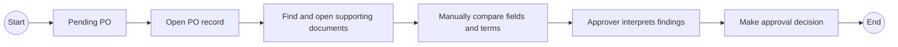
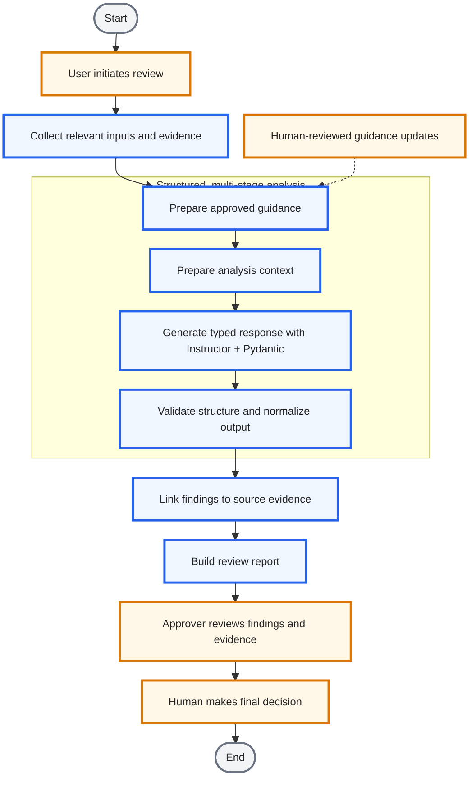

# AI-Assisted Procurement Review

> **Core outcome: a traffic-light review report (🟢 no discrepancy flagged / 🔴 review required) is designed to help senior approvers make informed decisions with less administrative cross-checking—while final judgment remains human.**
>
> An anonymized case study of a user-triggered Python workflow that uses an LLM to compare PO records with supporting documents and presents 🟢 / 🔴 findings with cited evidence. **Senior approvers** are leaders with approval authority.

## Contents

- **Business case — why it matters**
    - [Executive Summary](#executive-summary)
    - [Business Process: As-Is to To-Be](#business-process-as-is-to-to-be)
    - [Business Value and Evidence](#business-value-and-evidence)
        - [Measures for a future improvement phase](#measures-for-a-future-improvement-phase)
- **Solution design — how it works**
    - [Exception Feedback: Governed Improvement Loop](#exception-feedback-governed-improvement-loop)
    - [LLM Harness and Review Output](#llm-harness-and-review-output)
        - [Synthetic example of the generated report](#synthetic-example-of-the-generated-report)
        - [Summary view](#summary-view)
        - [Detailed comparison view](#detailed-comparison-view)
- **Delivery and trust — who did what, and what to know**
    - [My Role and Technology](#my-role-and-technology)
    - [Scope, Limitations, and Privacy](#scope-limitations-and-privacy)

## Executive Summary

### Business context and challenge

- **Approval context:** Enterprise POs typically pass through internal checkpoints before purchase release. Senior decision-makers need confidence that key commercial details are supported by the PO record and its evidence.
- **Review challenge:** Much of the review involves administrative, field-by-field reconciliation—checking quantities, prices, totals, and terms across the PO and its supporting documents. The challenge is that this transactional checking draws attention away from the approver's higher-level judgment: assessing exceptions and making the business approval decision.

### Solution and intended value

- **Solution:** A user-triggered Python workflow prepares inputs for multi-stage LLM analysis, validates structured outputs, and presents findings with source references for human review.
- **Intended value:** The report shifts the approver's starting point from raw information to an organized assessment, aiming to reduce administrative burden and focus attention on exceptions.

### Adoption and my contribution

- **Adoption:** The workflow was designed to support recurring review needs. No operational usage figures are disclosed.
- **My contribution:** I implemented and delivered the initial manager-defined concept. After launch, I independently designed and implemented a human-reviewed feedback loop that turns recurring observations into controlled guidance for future analyses, with project-PM review.

## Business Process: As-Is to To-Be

### As-Is — Manual comparison

### To-Be — Automated preparation, human decision

**Legend:** Orange = human action/input; blue = automated step; gray = start/end.

| Stage | What happens | Result passed forward |
|---|---|---|
| Input preparation | Collect and prepare relevant inputs and supporting evidence. | Analysis-ready context. |
| Structured LLM analysis | Orchestrate task-specific analysis using a typed response contract. | Consistent, machine-readable findings. |
| Output validation | Validate and normalize the response, then associate findings with source evidence. | Traceable results for review. |
| Human review | A reviewer examines findings and evidence before making a decision. | Human-owned final decision. |

## Business Value and Evidence

The value proposition is **decision-maker leverage**: evidence gathering and first-pass comparison are prepared before the report reaches the approver, who can start with 🟢 / 🔴 statuses, potential exceptions, and cited evidence rather than assembling comparisons from raw records.

**Evidence and limits:** This case study does not report verified outcome data. No before/after measurement was conducted, so time saved, improved accuracy, fewer control incidents, and financial return have not been established.

### Measures for a future improvement phase

To quantify value in a future phase, first agree KPI definitions and data ownership with the process owner, establish a baseline, and then track:

| Candidate measure | Example definition |
|---|---|
| Review cycle time | Time from run start to report availability; separately, report availability to human decision when timestamps exist. |
| Adoption and throughput | Run frequency and number of POs reviewed per run. |
| Finding quality | Share of AI-flagged checks confirmed, corrected, or dismissed by the human reviewer. |
| Evidence coverage | Share of reviewed POs with required checks and traceable source evidence. |

These are proposed measures, not current metrics or achieved results.

## Exception Feedback: Governed Improvement Loop

### My post-launch design contribution

The traffic-light report was part of the manager-defined initial concept. After launch, I identified a separate opportunity: recurring reviewer feedback could become reusable guidance instead of prompting repeated one-off edits. I independently designed and implemented a governed feedback loop to make that improvement repeatable.

The workflow turns feedback into guidance through a human-controlled lifecycle:

**Reviewer feedback → human review and curation → status-managed guidance → eligible guidance included in future prompt context**

The application uses active guidance in later analyses; archived guidance is not applied. People decide what becomes guidance and when it is active—the workflow does not autonomously learn from feedback or retrain the model.

### Illustrative guidance register

The table below is an independently authored illustration of the management concept, not a copy of the production register or a representation of actual business rules.

| Guidance ID | Guidance *(illustrative)* | Status |
|---|---|---|
| GEN-01 | When information is insufficient, state the uncertainty rather than inventing details. | Active |
| GEN-02 | Fill in missing details using the most common assumption. | Archived |

Status determines whether guidance is eligible for future prompt context. The example shows how guidance can be managed over time without exposing operational rules, feedback, or prompt wording.

## LLM Harness and Review Output

The harness uses schema-constrained generation to make LLM responses more predictable and easier to validate and integrate. Structured output does not guarantee factual correctness or eliminate hallucinations, so source evidence and human review remain necessary.

- **Pydantic** defines the typed response contract and validation constraints.
- **Instructor** requests LLM responses against that schema.
- The application validates and normalizes outputs before assembling the review report and associating findings with source evidence.

This design improves output consistency and downstream handling; it does not make the model's conclusions inherently correct.

### Synthetic example of the generated report

All identifiers, values, comments, and filenames below are invented for illustration. The review result is binary: 🟢 no discrepancy flagged or 🔴 review finding. 🟢 summary cells are intentionally blank; 🔴 summaries show the compared values directly.

#### Summary view

| PO record *(synthetic)* | PO-level status | PO-level summary | Line-item status | Line-item summary | Source evidence *(synthetic)* |
|---|---|---|---|---|---|
| PO-DEMO-001 | 🟢 |  | 🔴 | Item 2 tax rate: PO 8% vs. attachment 10%. | demo-quote-revB.pdf |
| PO-DEMO-002 | 🔴 | Payment terms: PO Net 30 vs. attachment Net 45. | 🟢 |  | demo-quote-v2.pdf |

#### Detailed comparison view

| PO *(synthetic)* | Review level | Checkpoint | PO value | Document value | Result | Reviewer note | Source evidence *(synthetic)* |
|---|---|---|---|---|---|---|---|
| PO-DEMO-001 | Line item | Tax rate — Item 2 | 8% | 10% | 🔴 Difference | Confirm the applicable treatment against the source document. | demo-quote-revB.pdf |
| PO-DEMO-001 | Line item | Item description — Item 1 | Standard adapter kit | Adapter kit, standard | 🟢 Match | Description is consistent; wording order differs. | demo-quote-revB.pdf |
| PO-DEMO-002 | PO-level | Payment terms | Net 30 | Net 45 | 🔴 Difference | Review the terms and any later supporting evidence. | demo-quote-v2.pdf |
| PO-DEMO-002 | PO-level | Warranty period | 12 months | 12 months | 🟢 Match | Values agree in the cited document. | demo-quote-v2.pdf |

Reviewers scan the summary, inspect 🔴 findings and cited sources, then make the decision. 🟢 is not approval, and 🔴 findings may need context because the model can be overly strict.

## My Role and Technology

### My role

- **Initial delivery:** My manager defined the business requirements and traffic-light reporting concept. I translated that direction into a working implementation and supported testing, acceptance, and deployment.
- **Post-launch improvement:** I independently identified the recurring feedback-management opportunity, designed the human-governed guidance loop, proposed it to the project PM, and completed its implementation and deployment.

### Technology used

Python · Playwright · Google Gemini (`google-genai`) · Instructor · Pydantic · Google Sheets

## Scope, Limitations, and Privacy

- This is AI-assisted PO review, not autonomous approval or end-to-end process mining.
- No cycle-time savings, accuracy improvement, or ROI has been measured.
- This portfolio case is anonymized. Company names, internal system identifiers, credentials, real prompts, transaction data, and proprietary rules are omitted. All examples are synthetic; no source code is included.
