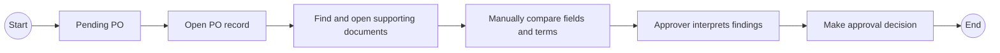
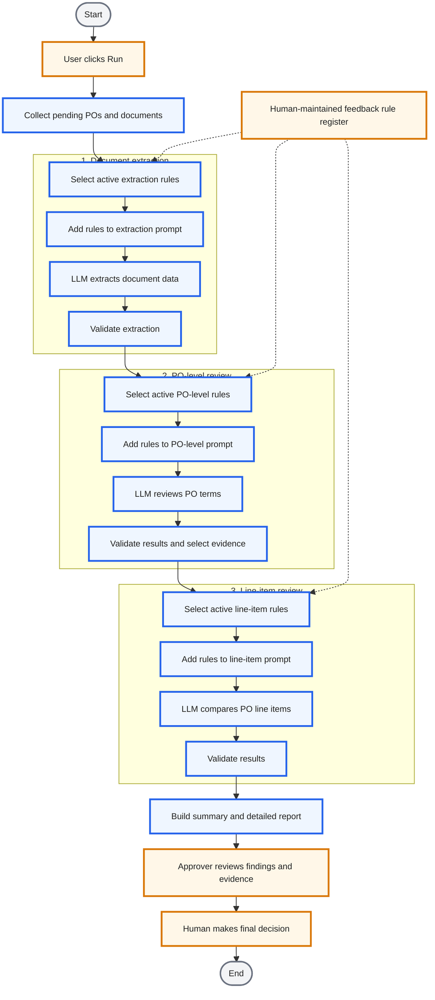

# AI-Assisted Procurement Review

> **An anonymized case study in turning repetitive document checks into structured, evidence-linked decision support—with a human retaining control.**
>
> A user-triggered Python workflow gathers purchase-order (PO) records and supporting documents, uses an LLM to extract and compare information, and presents potential exceptions to an approver. The AI prepares the review; it does not approve or reject transactions.

## Contents

- **Business case — why it matters**
    - [Executive Summary](#executive-summary)
    - [Business Process: As-Is to To-Be](#business-process-as-is-to-to-be)
    - [Business Value and Evidence](#business-value-and-evidence)
        - [Measures for a future improvement phase](#measures-for-a-future-improvement-phase)
- **Solution design — how it works**
    - [Exception Feedback: Governed Prompt Updates](#exception-feedback-governed-prompt-updates)
        - [Synthetic example of the rule register](#synthetic-example-of-the-rule-register)
    - [LLM Harness and Review Output](#llm-harness-and-review-output)
        - [Synthetic example of the generated report](#synthetic-example-of-the-generated-report)
        - [Summary view](#summary-view)
        - [Detailed comparison view](#detailed-comparison-view)
- **Delivery and trust — who did what, and what to know**
    - [My Role and Technology](#my-role-and-technology)
    - [Scope, Limitations, and Privacy](#scope-limitations-and-privacy)

## Executive Summary

- **Problem:** An approver needed to compare PO fields with information spread across supporting documents. Manually opening and cross-checking records created administrative work and made it harder to focus on exceptions.
- **Approach:** Automate data collection, use three category-specific LLM steps for document extraction, PO-level checks, and line-item checks, then consolidate results and source references into a report.
- **Business intent:** Make the review more consistent and direct attention to potential discrepancies while preserving human judgment and accountability.
- **Observed adoption:** The workflow ran **290 times in its first six months**; a typical run covered **1–4 POs**. The user described the report as helpful. No time-saving, accuracy, or ROI improvement has been measured.
- **My contribution:** I implemented and delivered the initial manager-defined concept. After launch, I independently identified, designed, and implemented a governed feedback-to-prompt mechanism for recurring exceptions, with project-PM review.

## Business Process: As-Is to To-Be

### As-Is — Manual comparison



### To-Be — Automated preparation, human decision

The user clicks **Run** to start the workflow. The automation prepares a first-pass review; the approver inspects findings and evidence before deciding.



**Legend:** Orange outline = human action/input; blue outline = automated step; gray rounded capsule = process start/end. Compact spacing and shorter labels keep the diagram easier to scan.

| Stage | What happens | Result passed forward |
|---|---|---|
| Document extraction | Apply active extraction rules; extract information from supported PDF/image attachments. | Structured document summary and line items. |
| PO-level review | Apply matching active rules; review overall terms such as payment terms and warranty, and identify relevant evidence. | PO-level checks and selected evidence context. |
| Line-item review | Apply matching active rules; compare PO line items with the selected evidence. | Item-level checks and comparison details. |

During workflow setup, active feedback rules are filtered by category and added to the corresponding prompt. Each LLM action receives only the guidance relevant to its category. The workflow then assembles the stage results into one report.

## Business Value and Evidence

The design is intended to reduce repetitive document searching and give the approver a more consistent, traceable first-pass review. The report brings together review status, differences, comments, and source-document references. This helps the user move from a batch-level overview to the specific evidence behind a potential exception.

**What has been observed:** 290 workflow runs in the first six months, typically processing 1–4 POs per run; the user said the report was helpful.

**What has not been established:** There is no before/after cycle-time study, measured accuracy or false-positive rate, or validated financial benefit. Usage demonstrates adoption, not quantified value realization.

### Measures for a future improvement phase

If the process owner wanted to quantify value, I would agree on definitions and data ownership first, then establish a baseline and track measures such as:

| Candidate measure | Example definition |
|---|---|
| Review cycle time | Time from run start to report availability; separately, report availability to human decision when timestamps exist. |
| Adoption and throughput | Run frequency and number of POs reviewed per run. |
| Finding quality | Share of AI-flagged checks confirmed, corrected, or dismissed by the human reviewer. |
| Evidence coverage | Share of reviewed POs with required checks and traceable source evidence. |

These are proposed measures—not metrics currently captured or results achieved.

## Exception Feedback: Governed Prompt Updates

After launch, recurring business exceptions led to repeated prompt edits. I designed a lightweight alternative: keep stable prompt content separate from a rule register, then use category and status to determine which reviewed guidance is supplied to each LLM step.

At workflow setup, the program loads the feedback rules, includes only rules marked **Active**, and routes them by category to document extraction, PO-level review, or line-item review. **Draft** rules remain out of the prompts. The mechanism is human-curated; it does not automatically learn from arbitrary feedback.

### Synthetic example of the rule register

The examples below are fictional and illustrate the management design only; they are not copied from real feedback or business rules.

| Category | User feedback *(synthetic)* | Curated prompt rule *(synthetic)* | Status |
|---|---|---|---|
| Document extraction | “The scan is faint. Please do not guess unreadable values.” | Mark values that cannot be read confidently as unavailable and surface them for human review. | 🟢 Active |
| PO-level review | “A quote may list an optional service separately from the goods.” | Do not include a clearly optional fee in a required-total comparison unless the PO includes it. | 🟢 Active |
| Line-item review | “The short product name differs, but the model identifier matches.” | Use an exact model identifier as matching evidence when available; flag conflicting identifiers. | 🟡 Draft |

I considered vector retrieval, but the observed rule volume was small enough to include relevant active guidance directly in the prompts. This workflow does not use embeddings or vector search.

## LLM Harness and Review Output

The goal of the LLM harness is to make responses more predictable and usable by downstream code—not to claim that schema validation prevents hallucinations or guarantees correct decisions.

- **Pydantic** models define required fields, nested audit checkpoints, and permitted status values.
- **Instructor** requests responses using those models.
- Validators normalize selected values, while application code assembles report rows from named checkpoints.
- Evidence references and human review provide context that a valid structure alone cannot establish.

Illustrative example only; this is not production code:

```python
from typing import Literal

from pydantic import BaseModel, Field


class Checkpoint(BaseModel):
    name: str
    system_value: str
    evidence_value: str
    status: Literal["GREEN", "RED"]
    explanation: str


class AuditReport(BaseModel):
    overall_status: Literal["GREEN", "RED"]
    checkpoints: list[Checkpoint] = Field(min_length=1)


report = instructor_client.chat.completions.create(
    model="configured-model",
    response_model=AuditReport,
    messages=[{"role": "user", "content": "Review the supplied synthetic evidence."}],
)
```

### Synthetic example of the generated report

All identifiers, values, comments, and filenames below are invented for illustration. Green summary fields are intentionally blank; red summaries show the compared values directly.

#### Summary view

| PO record *(synthetic)* | Workflow status | PO-level review | PO-level summary | Line-item review | Line-item summary | Source evidence *(synthetic)* |
|---|---|---|---|---|---|---|
| PO-DEMO-001 | 🟡 Pending human review | 🟢 |  | 🔴 | Item 2 tax rate: PO 8% vs. attachment 10%. | demo-quote-revB.pdf |
| PO-DEMO-002 | 🟡 Pending human review | 🔴 | Payment terms: PO Net 30 vs. attachment Net 45. | 🟢 |  | demo-quote-v2.pdf |

#### Detailed comparison view

| PO *(synthetic)* | Review level | Checkpoint | PO value | Document value | Result | Reviewer note | Source evidence *(synthetic)* |
|---|---|---|---|---|---|---|---|
| PO-DEMO-001 | Line item | Tax rate — Item 2 | 8% | 10% | 🔴 Difference | Confirm the applicable treatment against the source document. | demo-quote-revB.pdf |
| PO-DEMO-001 | Line item | Item description — Item 1 | Standard adapter kit | Adapter kit, standard | 🟢 Match | Description is consistent; wording order differs. | demo-quote-revB.pdf |
| PO-DEMO-002 | PO-level | Payment terms | Net 30 | Net 45 | 🔴 Difference | Review the terms and any later supporting evidence. | demo-quote-v2.pdf |
| PO-DEMO-002 | PO-level | Warranty period | 12 months | 12 months | 🟢 Match | Values agree in the cited document. | demo-quote-v2.pdf |

The intended review sequence is: scan the summary, inspect red findings in the detailed view, follow the source reference, and make the final decision. A green result is not an approval; a red result may also need contextual review because the model can be overly strict.

## My Role and Technology

### My role

- **Initial delivery:** The business requirements and high-level concept had already been established by my manager. I translated that direction into a working implementation and supported testing, acceptance, and deployment.
- **Post-launch improvement:** I identified the recurring exception-management problem, proposed the categorized and status-controlled prompt mechanism to the project PM, and independently completed its design, implementation, and deployment.

### Technology used

Python · Playwright · Google Gemini (`google-genai`) · Instructor · Pydantic · Google Sheets

## Scope, Limitations, and Privacy

- This is an AI-assisted PO review workflow, not an autonomous approval system or an end-to-end process-mining implementation.
- It does not claim measured cycle-time savings, error-rate improvement, or ROI.
- Structured outputs improve consistency of format; they do not guarantee factual correctness. Human review remains necessary.
- This portfolio case is anonymized. Company names, internal system identifiers, credentials, real prompts, transaction data, and proprietary rules are omitted. All examples are synthetic, and the code snippet is newly written for illustration.
